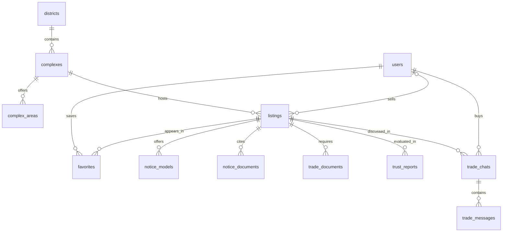
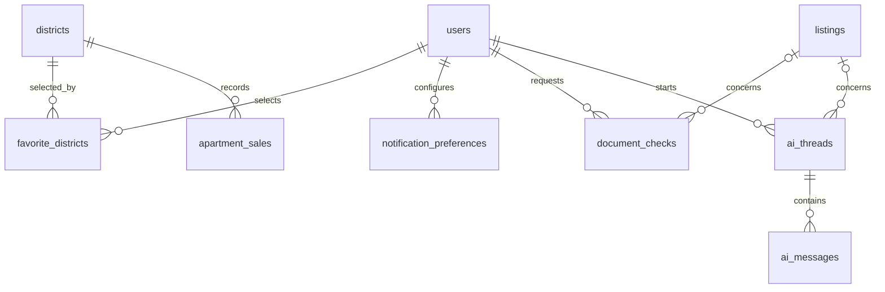

# 집콕 데이터베이스

로컬 개발 기준은 SQLite와 Node.js 24다. 별도 패키지 설치 없이 레포 루트에서 실행한다.

```sh
node db/manage.mjs migrate db/local.sqlite
node db/manage.mjs seed db/local.sqlite
node db/verify.mjs
```

migrate는 파일명 순으로 SQL을 적용하고 적용 이력을 같은 트랜잭션에 기록한다. 후속 변경은 다음 번호의 파일로 추가한다. seed는 빈 개발 DB에만 예제 데이터를 추가한다. 같은 시드를 다시 실행해도 기존 데이터를 보존한다. API에서 여는 **각 DB 연결**에 `PRAGMA foreign_keys=ON`을 설정한다.

## ERD





## 화면과 API 연결

서버에서는 `db/listings.mjs`의 `listCards`로 main의 Listing 카드 배열을 읽는다. 기본 정렬은 최신 등록순이다. 서버에서 인증한 사용자 ID를 전달하면 카드별 찜 상태가 포함된다.

```js
import { listCards } from './db/listings.mjs';

const feed = listCards(db);
const saved = listCards(db, { scope: 'favorites', userId });
const myListings = listCards(db, { scope: 'mine', userId });
```

검토 대기 매물은 판매자 본인의 등록 목록에서 확인할 수 있다. 청약 접수 시작일과 마감일은 한국 시간 기준으로 당일을 포함한다.

| 기능 | 읽기·쓰기 규약 |
|---|---|
| 매물 탭 | 공개 목록은 public_listings를 사용한다. complexes에서 주소·좌표·사진을, districts에서 시군구를 가져온다. 좌표가 비어 있으면 목록에만 표시한다. |
| 분양권 | 분양가·프리미엄·옵션비·납부액은 원 단위 정수다. 판매 상태와 거래방 상태는 별개다. 내가 등록한 매물은 listings.seller_id로 조회한다. |
| 관심 | 로그인 사용자와 매물 ID 조합으로 favorites를 조회한다. liked는 사용자마다 계산한다. |
| 거래 채팅 | 한 매물과 구매자당 한 방이다. API가 인증 사용자와 방의 구매자·판매자를 대조한 뒤 author_role을 정한다. |
| 서류·신뢰도 | trade_documents는 서류 종류별 현재 상태, trust_reports는 매물 검증 이력이다. report_json에는 프론트 TrustReport 전체를 보관한다. document_checks는 사용자가 별도로 요청한 파일 점검 이력이다. |
| 청약홈 | notices[].id 및 notice_number는 문자열 쌍으로 식별한다. housing_types는 notice_models에, documents는 notice_documents에 연결한다. 모델번호의 선행 0을 유지하고 만 원은 원으로 환산한다. 조회 실패(null) 시 기존 자식 데이터를 유지한다. |
| 아파트 실거래가 | apartment_sales는 시군구와 계약일로 조회한다. 외부 거래에 집콕 매물 ID를 추정해 붙이지 않는다. 월별 재수집 시 조회가 완결된 범위만 트랜잭션 안에서 교체한다. |
| MY·AI | 관심지역·알림 설정·서류점검·AI 대화를 사용자별로 조회한다. membership은 현재 등급을 저장한다. |

개발 시드는 main의 매물 4건 및 예나의 찜 2건을 재현한다. 판매자·금액 세부 구성·등록 시각·채팅은 로컬 예시다. 화면의 상대 날짜·가격 문자열·배지 색은 표시할 때 계산한다.

기준 브랜치는 main (6af1898), 분양권 모델은 feature/presale-trade (176a8a5), 외부 데이터 형식은 feature/api (15e5277)다. 이 폴더는 DB 계층만 제공한다. 실제 API 연결, 인증, 공공데이터 수집 작업은 별도 연동 범위다.
